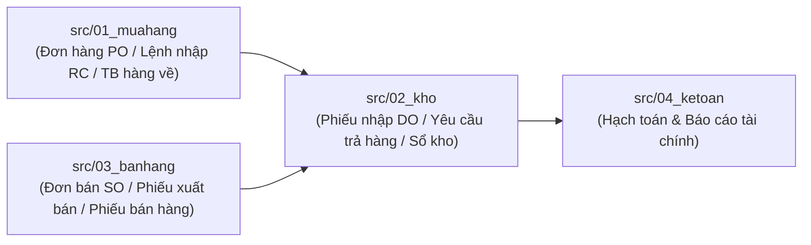

# HaiSauSau - BRAVO ERP Database Customization

Dự án quản lý tập trung toàn bộ mã nguồn cơ sở dữ liệu (PostgreSQL / SQL Server), cấu hình Layout giao diện XML và tài liệu đặc tả cấu trúc bảng phục vụ tùy biến cho **Hệ thống ERP BRAVO 8.x**.

---

## 📌 Tổng quan Phân hệ Nghiệp vụ

Repository bao gồm các module nghiệp vụ liên kết chuỗi cung ứng khép kín:

### 1. Phân hệ Hệ thống & Dùng chung (`src/00_system/`)
- **Quản lý Catalog & Thông tin hệ thống:** `functions/ufn_update_catalog_info.sql`
- **Command & Lệnh hệ thống:** `views/vb00command.sql`

### 2. Phân hệ Mua hàng (`src/01_muahang/`)
- **Theo dõi Đơn đặt hàng mua (PO):** `functions/ufn_vct_purchaseorderlist.sql`
- **Lệnh nhập hàng & Kế thừa dữ liệu PO:** `functions/ufn_b30bizdoc_convertfromb30bizdocdetail_rc.sql`, `functions/ufn_vct_receiptcommandlist.sql`
- **Thủ tục & View chi tiết chứng từ:** `procedures/usp_b30bizdocdetail_getdata.sql`, `views/vb30bizdocdetail_getdatapo_item.sql`, `views/vb30bizdoc_explore.sql`, `views/vb30bizdocdetail_getdata.sql`, `views/vb30bizdocdetail_getdata_all.sql`

### 3. Phân hệ Quản lý Kho (`src/02_kho/`)
- **Nhập kho & Đối chiếu Thông báo hàng về:** `functions/ufn_b30statsdocitem_convertfromb30bizdocdetail_do.sql`, `functions/ufn_vct_goodsarrivalnoticelist.sql`
- **Trả hàng Nhà cung cấp:** `functions/ufn_b30bizdocdetail_convertfrom_b30statsdocitem_sn.sql`, `functions/ufn_stats_Trackwarehousereceipts.sql`, `functions/ufn_b30statsdocitem_convertfromb30bizdocdetail_rr.sql`, `functions/ufn_biz_Track_Supplier_Return_Requests.sql`
- **Sổ kho, Thẻ kho & Tổng hợp tồn:** `views/vb30statsstockledger_post.sql`, `functions/ufn_wh_vct_activitybyserialno.sql`, `functions/ufn_Stats_ItemSummary.sql`
- **View giao diện nhập liệu / tồn kho:** `views/vb30statsdocinventory.sql`, `views/vb30statsdocinventory_edit.sql`, `views/vb30statsdocitem_explore.sql`
- **Thủ tục xử lý kho:** `procedures/usp_b30statsdocitem_post.sql`

### 4. Phân hệ Bán hàng (`src/03_banhang/`)
- **Theo dõi Phiếu bán hàng & Kế thừa chi tiết:** `functions/ufn_b30statsdocitem_convertfromb30bizdocdetail_bh.sql`, `functions/ufn_vct_salesvoucherlist.sql`
- **Theo dõi Đơn đặt hàng bán & Phiếu xuất kho bán hàng**

### 5. Phân hệ Kế toán (`src/04_ketoan/`)
- Đang chuẩn bị tích hợp các module hạch toán tự động và sổ cái.

### 6. Tài liệu & Layouts (`docs/` & `layouts/`)
- **Tài liệu đặc tả CSDL (`docs/schemas/`):** Các bảng cấu trúc Kho (`B30StatsDoc`), Hàng hóa (`B20Item`), Danh mục chứng từ (`B20Dmct`), Quy trình (`Process_Sys`), PO (`B30BizDocPO`).
- **Hướng dẫn sử dụng (`docs/user-guides/`):** Tài liệu hướng dẫn sử dụng các hàm hệ thống.
- **Cấu hình Layout BRAVO (`layouts/`):** Lưu định dạng XML cấu hình giao diện BRAVO UI (`editor_layout.xml`, `explo_layout.xml`...).

---

## 📐 Quy chuẩn Đặt tên & Lập trình (Coding Conventions)

Để duy trì chất lượng mã nguồn đồng nhất khi làm việc nhóm và bàn giao:

### 1. Đối tượng Cơ sở Dữ liệu (Database Objects)
| Tiền tố | Loại đối tượng | Ví dụ | Mục đích |
| :--- | :--- | :--- | :--- |
| `ufn_` | User-Defined Function | `ufn_vct_purchaseorderlist` | Hàm trả về bảng/bản ghi hoặc giá trị tính toán |
| `usp_` | Stored Procedure | `usp_b30bizdocdetail_getdata` | Thủ tục xử lý nghiệp vụ/cập nhật dữ liệu |
| `vb` / `v` | View | `vb30statsdocinventory` | View tổng hợp dữ liệu giao diện hoặc báo cáo |
| `Tmp_` | Temp Table | `Tmp_V_CtTmp_PO` | Bảng tạm dùng nội bộ trong function/procedure |

### 2. Quy tắc Quản lý Mã nguồn với Git
- **Không đặt hậu tố thủ công:** Tuyệt đối **không** tạo các file có đuôi `_old`, `_final`, `_v2`. Mọi thay đổi lịch sử đều được quản lý bằng Git commit.
- **Không commit file trùng lặp:** Mỗi đối tượng SQL chỉ được quản lý tại **01 file duy nhất** theo đúng phân hệ sở hữu.
- **Không đặt tên folder cá nhân:** Các script tiện ích, công cụ debug dùng chung phải đưa vào thư mục chung (`tools/` hoặc `scripts/`), không tạo folder theo tên dev (ví dụ `TINNT_...`).
- **Encoding:** Toàn bộ file SQL lưu dưới định dạng **UTF-8 with BOM** (hoặc UTF-8) để bảo toàn tiếng Việt có dấu trong chú thích và chuỗi giao diện.

---

## 🚀 Hướng dẫn Triển khai (Deployment Guide)

Khi cập nhật dữ liệu lên hệ thống ERP BRAVO, hãy tuân thủ thứ tự thực thi script:

1. **Bước 1 - DDL & Cấu trúc bảng (nếu có):** Thêm trường, tạo bảng mới trong schema `dbo`.
2. **Bước 2 - Views hệ thống & View danh mục:**
   - Cập nhật các view cơ sở (Base Views).
3. **Bước 3 - Functions tính toán & kế thừa (`ufn_*`):**
   - Biên dịch các hàm kế thừa dữ liệu chứng từ (`convertfrom...`).
   - Biên dịch các hàm báo cáo / theo dõi (`ufn_vct_*`).
4. **Bước 4 - Stored Procedures (`usp_*`):**
   - Biên dịch thủ tục post sổ kho, lấy dữ liệu chứng từ.
5. **Bước 5 - Cấu hình Layout UI trên phần mềm BRAVO:**
   - Import XML Datasource và Layout vào màn hình tương ứng.

> ⚠️ **Lưu ý an toàn:** Luôn chạy script kiểm tra cú pháp trên Database Test trước khi áp dụng lên môi trường Production. Đảm bảo đã sao lưu (Backup) CSDL trước mỗi đợt phát hành lớn.

---

## 🛠 Công cụ & Hỗ trợ Phát triển (Dev Tools)

- **Sinh View tự động (PostgreSQL / MSSQL):** `tools/generators/`
- **Quy chuẩn Code Style SQL:** Cấu hình định dạng chuẩn trong `tools/formatting/sqlstyle.json`.
